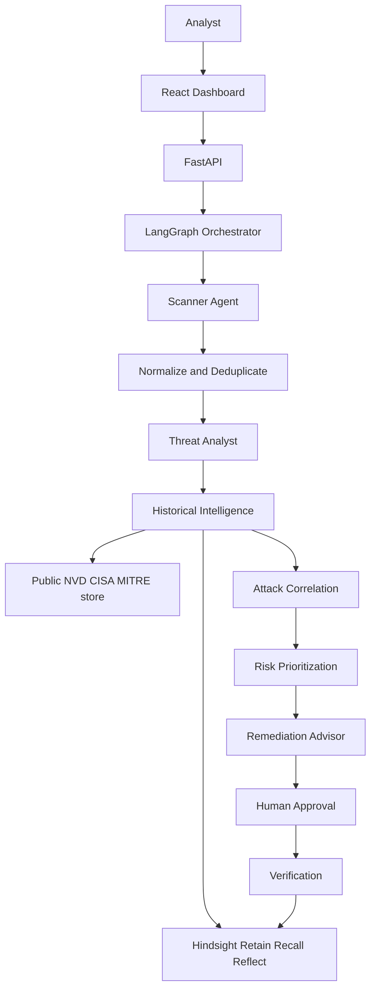

# SentinelMind

AI Security Incident Intelligence Agent with persistent learning using Hindsight.

SentinelMind scans authorized projects, correlates findings into attack paths, recalls prior investigations from Hindsight, and recommends remediations that improve after verification outcomes are retained.

**Central claim:** SentinelMind does not only detect vulnerabilities. It learns from security incidents and uses that experience to change risk ranking and remediation advice.

## Problem

Separate scanners report isolated issues: an exposed secret, an outdated PHP runtime, a dangerous CGI mapping, a root database user. Individually they look like different tickets. Together they can be a data-breach path.

In October 2026, CISA urged immediate patching of **PHP2Shell** (`CVE-2026-109618` and `CVE-2026-109619`) — unauthenticated RCE in PHP serving web requests (mod_php, PHP-FPM, php-cgi, and related SAPIs). SentinelMind’s native engine detects that runtime posture plus application bugs that turn engine RCE into credential theft and database exfiltration.

## Innovation

Hindsight is the persistent agent memory, not a document search widget.

| Operation | What SentinelMind stores / retrieves |
| --- | --- |
| Retain | Findings that matter, attack relationships, org context, remediation success/failure, verification results |
| Recall | Prior incidents, failed fixes, successful patches for the current CVE/CWE/tech |
| Reflect | Cross-investigation patterns when the official Hindsight API supports it |

Public CVE/CWE/ATT&CK knowledge is stored in PostgreSQL/SQLite. Organizational experience lives in Hindsight. The UI labels both.

Hindsight is enabled in real mode by default. If the daemon is unavailable, scanners still run, the UI displays an explicit offline warning, and memory operations do not silently switch to local data. To opt into the development JSON adapter, set `HINDSIGHT_MODE=mock`; its memories are separately labelled as local mock data.

## Features

- Upload a ZIP, paste a GitHub/website link, or run the 2026 PHP demo
- Native scanner finds PHP2Shell (`CVE-2026-109618` / `CVE-2026-109619`) plus app bugs
- Bugs view shows similar incidents, fixes that worked, and fixes that failed from Hindsight
- Website links are inspected passively (headers/HTML only). No exploit is sent.
- Optional Semgrep, Gitleaks, OSV-Scanner, Trivy when installed
- Simple UI: **Scan**, **Bugs**, **Memory**

## System architecture



## Technology stack

- Frontend: React, TypeScript, Vite, Tailwind CSS, Recharts, Lucide
- Backend: Python 3.11+, FastAPI, Pydantic, SQLAlchemy, SQLite (default) or PostgreSQL
- Agents: LangGraph; Groq LLM when `GROQ_API_KEY` is set, otherwise deterministic analysis
- Memory: official `hindsight-client` (`retain` / `recall` / `reflect`) against `HINDSIGHT_BASE_URL`
- Scanners: built-in native engine; Semgrep, Gitleaks, OSV-Scanner, Trivy when installed on PATH

## Installation

### Backend

```powershell
cd backend
python -m venv .venv
.\.venv\Scripts\activate
pip install -r requirements.txt
copy .env.example .env
```

### Frontend

```powershell
cd frontend
npm install
```

## Environment setup

Copy `backend/.env.example` to `backend/.env`. Important variables:

| Variable | Purpose |
| --- | --- |
| `GROQ_API_KEY` / `GROQ_MODEL` | Optional LLM explanations |
| `HINDSIGHT_BASE_URL` | Default `http://localhost:8888` |
| `HINDSIGHT_API_KEY` | Optional, if your Hindsight deployment requires it |
| `HINDSIGHT_BANK_ID` | Memory bank (`sentinelmind-secops`) |
| `HINDSIGHT_MODE` | `real` by default; `mock` explicitly selects the local development adapter |
| `HINDSIGHT_TIMEOUT_SECONDS` | SDK request and retain-operation timeout (default 30 seconds) |
| `DATABASE_URL` | SQLite by default, or PostgreSQL |
| `BACKEND_HOST` / `BACKEND_PORT` | API bind |
| `FRONTEND_URL` | CORS origin |
| `UPLOAD_DIRECTORY` / `MAX_UPLOAD_SIZE_MB` | Archive limits |

### Install and start Hindsight natively on Windows

Hindsight supports a native Windows install with its embedded PostgreSQL database. The project keeps the server in its own Python 3.13 environment, separate from SentinelMind's backend environment. Start Ollama locally and make sure the configured model exists (`ollama pull qwen2.5:0.5b`). The launcher uses Hindsight's documented Ollama provider at `http://localhost:11434/v1`, configures chunk retention so incident records are stored verbatim without slow LLM extraction, and starts the API on `localhost:8888`. Reflect still uses the local model and can take tens of seconds on CPU. Hindsight's embedding and reranking models download on first launch.

```powershell
cd backend
uv --cache-dir ..\.uv-cache venv --allow-existing --python 3.13 .hindsight-venv
uv --cache-dir ..\.uv-cache pip install --python .hindsight-venv\Scripts\python.exe -r hindsight-server-requirements.txt
.\start_hindsight.ps1
```

Hindsight's embedded database persists in the user's `.hindsight` data directory. Keep `HINDSIGHT_MODE=real`, `HINDSIGHT_BASE_URL=http://localhost:8888`, and `HINDSIGHT_BANK_ID=sentinelmind-secops` in `backend/.env`. The app's active timeout is 90 seconds to allow for local inference. Local API authentication is optional; the backend key is only needed if the server is configured to require it.

To deliberately use the local development adapter instead, set `HINDSIGHT_MODE=mock`. This mode is never selected automatically. The integration test against a real daemon (including client recreation to verify persistence across an application restart) is:

```powershell
$env:HINDSIGHT_INTEGRATION_TEST = "1"
cd backend
python -m pytest tests/test_hindsight_persistence_integration.py -q
```

It is skipped unless explicitly enabled and requires the configured daemon to be accessible. It writes only to `sentinelmind-secops-integration-test`; set `HINDSIGHT_TEST_BANK_ID` to override that isolated test bank.

Do not put real secrets in source files.

## Backend startup

```powershell
cd backend
.\.venv\Scripts\activate
python -m uvicorn app.main:app --host 127.0.0.1 --port 8000
```

OpenAPI: http://127.0.0.1:8000/docs

## Frontend startup

```powershell
cd frontend
npm run dev
```

UI: http://127.0.0.1:5173 (proxies `/api` to the backend)

## Scanner installation

The native engine always runs. Optional CLIs:

```text
pip install semgrep
# https://github.com/gitleaks/gitleaks/releases
# https://google.github.io/osv-scanner/
# https://trivy.dev
```

If a CLI is missing, health and scan results report it as unavailable. SentinelMind does not invent findings for missing scanners.

## Historical knowledge ingestion

Baseline NVD/CISA/MITRE records (including PHP2Shell) seed on API startup.

```powershell
cd backend
python -m app.cli ingest-knowledge
python -m app.cli ingest-knowledge --fetch-cisa-kev
python -m app.cli seed-demo-memory
```

`--fetch-cisa-kev` downloads the official CISA KEV JSON (not HTML scraping), caches it, and keeps PHP-related entries.

## Demo walkthrough

1. Start backend and frontend.
2. Open the dashboard. Memory banner shows Official Hindsight or Local Fallback.
3. New Investigation → **1-Click Scan Benchmark** (synthetic PHP 2026 fixture).
4. Confirm findings include `CVE-2026-109618`, `CVE-2026-109619`, leaked DB credentials, SQLi, and unserialize.
5. Open Before vs After Memory. Both columns use the same scan.
6. Approve a remediation, then record verification. A subsequent investigation can recall that outcome.

The fixture under `backend/app/fixtures/synthetic_php_project` is **SYNTHETIC DEMONSTRATION DATA**.

## Before/after memory demonstration

- **Without memory:** scanner evidence + public CVE/CISA knowledge only.
- **With memory:** same findings plus Hindsight recalls of labelled incident `SEC-2026-110` (failed WAF-only fix, successful PHP upgrade + credential rotation).

The no-memory path is not dumbed down. The delta is historical context: confirmed chaining, higher risk, and rejection of previously failed fixes.

## Testing

```powershell
cd backend
python -m pytest
cd ..\frontend
npm run build
```

Results should be taken from the last command you actually ran. Tests mock or fall back Hindsight when the daemon is down.

## Limitations

- Native PHP rules are pattern-based SAST, not a full AST or runtime fuzzer.
- PHP2Shell is an engine bug; the scanner infers exposure from version pins and php.ini/Apache/Docker evidence.
- Optional scanners only run when installed.
- Groq and Hindsight require credentials/daemons you provide.
- Remediation never patches hosts, rotates live credentials, or executes uploaded project code.

## Security and authorization

Only scan systems you are authorized to assess. See `docs/SECURITY_MODEL.md`.

Further reading:

- `docs/ARCHITECTURE.md`
- `docs/HINDSIGHT_INTEGRATION.md`
- `docs/DEMO_SCRIPT.md`
- `docs/SECURITY_MODEL.md`
